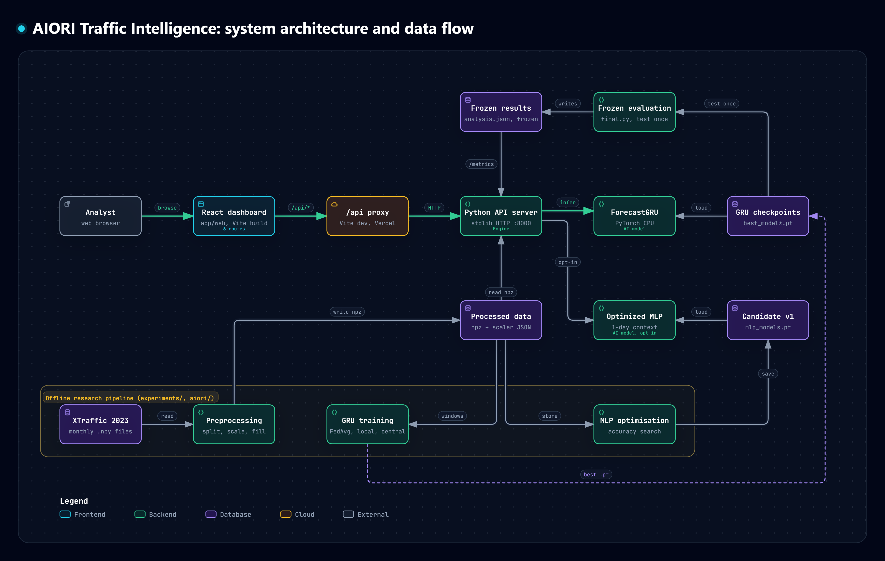

## AIORI-3-HACKATHON-PROJECTS
### Team Name : Cors Enabled
### Team Code : A3-PS003-TC188
### PS-003: Federated Traffic-Flow Prediction with Communication-Cost Evaluation
#### YouTube video link : https://youtu.be/RmcWK-jka4o
#### Live Deployment link : https://dawn-dts-silver-pal.trycloudflare.com/

---

# AIORI Traffic Intelligence

Next-hour freeway traffic-flow forecasting on the XTraffic 2023 dataset. The project compares several ways of training a forecaster across four geographic clients, and measures the communication cost of federation:
- **centralised:** all data pooled;
- **local-only:** each client trains alone;
- **federated:** IID FedAvg and geographic FedAvg.

It also includes a full-stack dashboard that runs the trained models on demand.

## Key results

Every model forecasts the next 12 five-minute intervals (60 minutes) for 200 sensors in four simulated geographic clients. WAPE is total absolute error divided by total observed traffic; lower is better.

| Model | Evaluation period | WAPE |
|---|---|---|
| **Optimized MLP** (1-day context, trained independently per client) | Oct – Dec 2023, independent, evaluated once | **7.669%** |
| Original GRU (local-only, study final model) | Oct – Dec 2023, same windows | 8.834% |
| Naive persistence | Oct – Dec 2023, same windows | 12.678% |
| Original GRU | Aug 8 – Sep 30, 2023 held-out test | 8.672% |

- **Against the original GRU:** the optimized MLP has **13.2% lower error** on the same independent October–December windows.
- **Against naive persistence:** 39.5% lower error on those windows.
- **Validation:** the optimized MLP's validation WAPE is 6.794% (Jul 11 – Aug 7, 2023).
- **Not federated:** the optimized MLP is trained independently on each client's own data.
- **Target:** the project's 6% WAPE target has not been reached by any evaluated model.

**Federated vs independent training** (Aug 8 – Sep 30, 2023 held-out test, mean MAE of 3 seeds, vehicles per 5 minutes):

| Approach | MAE | WAPE |
|---|---|---|
| Local-only GRU | 16.990 | 8.675% (8.672% clipped at 0) |
| Centralised GRU | 17.134 | 8.749% |
| IID FedAvg | 17.274 | 8.820% |
| Geographic FedAvg | 17.362 | 8.865% |
| Naive persistence | 24.421 | 12.470% |

- Geographic FedAvg cost 0.228 MAE against centralised training and 0.372 against local-only training. Both differences exceed the pre-declared practical threshold.
- Local-only and centralised training could not be told apart.
- **Details:** `docs/phase9_results.md`, `docs/phase9_percentage_error.md` and `docs/accuracy_optimization_report.md`.

## Methodology
- **Data:** XTraffic 2023 five-minute flow, January – September for development and October – December for one independent evaluation. 200 sensors, 50 per client group, were chosen with training-period statistics only.
- **Chronological split:**
  - train Jan 1 – Jul 10 (191 days);
  - validation Jul 11 – Aug 7 (28 days);
  - held-out test Aug 8 – Sep 30 (54 days).
- **Preprocessing:** per-sensor scaling fitted on training data only, and causal filling of missing inputs (no future values).
- **Selection:** models are chosen on validation data. The test period was evaluated once; October – December was opened once, after selection, under a protocol committed in advance (`docs/accuracy_optimization_protocol.md`).
- **Models:**
  - **Original:** a compact GRU (4 input features → 64 hidden units → 12 outputs).
  - **Optimized:** a residual MLP over the last 288 steps (one day), with:
    - time-of-day and weekday covariates;
    - each sensor's training-period weekday profile;
    - same-time-yesterday and same-time-last-week readings;
    - a sensor embedding;
    - an L1 loss matched to WAPE.
- **Federation:** simulated in one process (FedAvg). Communication is counted as model weights exchanged, not measured on a network.

## Dashboard
- **Pages:**
  - Overview;
  - Forecasting: historical replay, or future forecasts from 12 readings with CSV upload;
  - Model performance;
  - Federated learning;
  - Methodology;
  - About.
- **Back end:** a Python standard-library HTTP API running real PyTorch inference (`app/backend`).
- **Front end:** React 19, TypeScript, Vite, Tailwind CSS, React Router, Recharts and Lucide (`src/app/web`).
- **Which model forecasts:**
  - Historical replay uses the optimized MLP when `AIORI_CANDIDATE=1` is set, because it needs one week of history.
  - Forecasts from 12 user readings use the original GRU.
- **Labelling:** forecasts after September 2023 are marked as not validated.

## System Architecture


The diagram shows the serving path (browser → React dashboard → `/api` → Python API server → ForecastGRU and the optional
optimized MLP) and the offline research pipeline that produces the processed data, checkpoints and frozen results.
There is no database server: all state is files loaded once at start-up.
[Open the interactive version](architecture/aiori-system-architecture.html) (download the file and open it in a browser;
GitHub shows HTML files as source).

## Repository layout
```
src/aiori/                   data loading, preprocessing, windows, models, training, federated learning, metrics
src/experiments/             study runners (Phase 6-9) and accuracy optimisation (src/experiments/accuracy_optimization)
src/app/backend/             inference API (server.py) and optional optimized model (candidate.py)
src/app/web/                 React dashboard
src/app/frontend/            earlier dependency-free dashboard (fallback)
src/app/tests/, src/tests/   API, inference-equivalence, privacy and study tests
src/docs/                    protocols, results, reproduction guide and reports
src/scripts/, src/deploy/    analysis/verification scripts and optional deployment files
```
Local data, checkpoints and results (git-ignored) live beside the code under `src/` (`src/data`, `src/results`,
`src/year_2023`). The virtual environment `.venv` stays at the repository root, and every command below runs from there.
```
```

## Setup and running (Windows)
**Prerequisites:** Python 3.12 and Node.js 22 LTS or newer.

1. Create the Python environment:
   ```powershell
   py -3.12 -m venv .venv
   .venv\Scripts\python.exe -m pip install numpy==2.5.4 pandas==3.1.0 pytest==9.1.1
   .venv\Scripts\python.exe -m pip install torch==2.14.1+cpu --index-url https://download.pytorch.org/whl/cpu
   ```
2. Build the dashboard:
   ```powershell
   cd src\app\web
   npm ci
   npm run build
   cd ..\..\..
   ```
3. Start the service, then open http://127.0.0.1:8000:
   ```powershell
   .venv\Scripts\python.exe src\app\backend\server.py
   ```
   To serve the optimized model for historical replay, set `AIORI_CANDIDATE=1` first (PowerShell: `$env:AIORI_CANDIDATE = "1"`).
4. Run the tests:
   ```powershell
   .venv\Scripts\python.exe -m pytest src\app\tests src\tests
   cd src\app\web; npm test
   ```

**Front-end development:** with the API running, `npm run dev` in `src/app/web` serves the app on http://localhost:5173 and proxies `/api` to the API.

**Configuration:** environment variables, endpoints and deployment options are listed in `src/app/README.md`.

## Data and privacy
- **Raw data:** XTraffic 2023 is licensed CC BY-NC 4.0. Raw data, processed arrays, model checkpoints, predictions and station identifiers are not included in this repository.
- **Local artifacts needed to run:** the API needs the locally generated artifacts under `data/processed/` and `results/`. `docs/phase9_reproduction.md` describes how to regenerate them from the raw files.
- **API privacy:** responses use anonymised sensor ids (for example `LA-01`) and never expose station ids, file paths or checkpoints.
- **Geography:** the client geography comes from a sensor-ID mapping that is supported but not confirmed, so it is treated as provisional.
- **Not live:** forecasts are research demonstrations on historical data, not live traffic advisories.
